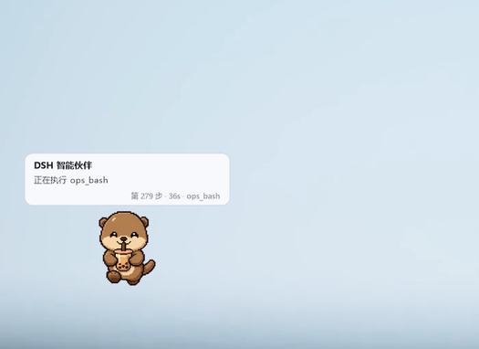
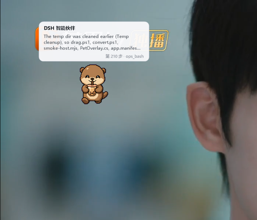

# dsh-pet · DSH 常驻宠物浮层

把 Codex 桌面版的"智能伙伴"搬到了 DeepSeek Harness：一只始终浮在屏幕最上层的宠物，
**不打开面板也能看到当前对话在做什么**，**任务一结束立刻冒出来提醒你**，还能从
[petdex.dev](https://petdex.dev) 直接装别人的宠物。



| 任务结束提醒 | 面板最小化时仍在 | 拖到屏幕任意位置 |
| --- | --- | --- |
|  |  |  |

> 方案与关键设计：[docs/DESIGN.html](docs/DESIGN.html)（带图，推荐）／ [docs/DESIGN.md](docs/DESIGN.md)。
> 失败态长这样：`docs/img/13-alert-failed.png`（红 ✕ + 原因），成功态：`docs/img/12-alert-success.png`。

## 它解决什么问题

DSH 面板被最小化/被其他窗口盖住之后，你不知道 agent 还在跑、跑到哪一步、是不是已经跑完在等你。
这个插件在系统层面开了一个独立浮层：**不属于 DSH 窗口，不受任何面板裁剪**，
把"最新一条消息 + 进度"一直摆在桌面上。

## 特性

- **常驻浮层**：分层窗口 + 逐像素命中测试，宠物之外的区域完全点击穿透，不挡你操作别的软件。
- **实时进度**：标题（会话名）、正文（最新一条 assistant 消息）、页脚（第几轮 · 第几步 · 用时 · 当前工具）。
- **结束必达**：根会话 `turn/end` 一到，四路提醒同时来——气泡 `✔ 任务已完成，可以回来看了`（失败是红 `✕` + 原因）、
  宠物跳跃然后招手、托盘系统通知（点一下就确认）、提示音。
- **等你会意**：审批 / 提问挂起时切到 `waiting` 状态与"在等你确认后继续…"文案（只跟当前会话，后台子 agent 的审批不会抢气泡）。
- **全屏拖动**：拖到屏幕任意位置、跨显示器都行，位置写盘，重启恢复。
- **宠物自定义**：托盘菜单里粘贴 petdex 的宠物链接即可安装，装完立即换装、无需重启。
- **多宠物**：装几个就能在菜单里勾选切换；缩放 40%–125%；气泡/提示音/托盘提醒可分别开关。
- **配置持久化**：`~/.dsh/pets/config.json` 原子写入（tmp + rename），重启 / 换宠物 / 换缩放后位置与选择原样恢复。
- **`/pet` 命令**：在对话里直接敲 `/pet status`、`/pet install boba`、`/pet pet deepseek`、`/pet scale 70`、`/pet test`，不用开托盘。

## 安装

前置：Windows（浮层是原生 C#/.NET Framework 4.x 进程，编译用系统自带 `csc.exe`）、
DSH ≥ 0.2.1-rc.3、Node ≥ 22.6。

```text
# 在 DSH 里执行（或让 agent 执行）
plugin_manager action=install_bundle target="C:\Users\KING\Documents\deepseek-harness\default-workspace\projects\dsh-pet"
```

安装成功后插件会自己：

1. 在 DSH 的 web 端口上挂 `/x-dsh-pet/*`（仅回环地址 + 每次启动随机 token；前缀被占用时自动退到 `/x-dsh-pet-2`，
   并把实际前缀写进 `~/.dsh/pets/runtime.json`）；
2. 用 `csc.exe` 把 `native/PetOverlay.cs` 编译到 `~/.dsh/pets/bin/PetOverlay.exe`；
3. 拉起浮层进程（带单实例互斥量，重启时先杀掉旧进程）；
4. 如果本地还没有任何宠物，自动从 petdex 装一只 `deepseek`（也就是 `deepseek酱`）。

不想自动装？把 `~/.dsh/pets/config.json` 里的 `pet` 置空并删掉 `~/.dsh/pets/deepseek/` 即可。

## 使用

**宠物本体**

| 操作 | 效果 |
| --- | --- |
| 左键拖动 | 全屏任意位置移动（松手即存盘） |
| 单击 | 展开/收起气泡；有结束提醒时单击视为"我知道了" |
| 双击 | 把 DSH 主窗口调到前台 |
| 右键 | 打开菜单（宠物 / 缩放 / 气泡 / 提示音 / 测试提醒 / 重置位置 / 退出） |

**托盘菜单**（右键宠物即托盘同款）

- 打开 DSH
- 切换宠物 ▶（列出已装宠物，✓ 表示当前；含「安装 petdex 宠物…」「打开宠物目录」）
- 缩放 ▶（40% / 55% / 70% / 85% / 100% / 125%）
- 显示对话气泡 / 结束提示音 / 结束时弹系统通知（勾选式开关，真 ✓ 而不是文字符号）
- 测试结束提醒（立刻演练一次整套提醒；子项可选成功 / 失败两种演练）
- 重置位置（回到**当前屏幕**右下角）/ 退出宠物窗

**装 petdex 宠物**

三种输入都支持（托盘 → 切换宠物 → 安装 petdex 宠物…）：

```text
boba                                  # 纯 slug
https://petdex.dev/pets/boba          # 宠物页链接
C:\path\to\pet-folder-or.zip          # 本地目录 / 本地 zip
```

装完后宠物会立刻换装并写进配置。等价命令：`/pet install https://petdex.dev/pets/boba`。

**对话里的 `/pet` 命令**（不依赖浮层的自检入口，浮层起不来时也能用）

```text
/pet                        # 状态：浮层是否在跑、当前宠物、开关、缩放、待确认提醒、日志路径
/pet pets                   # 列出已装宠物
/pet pet deepseek           # 切换宠物
/pet scale 70               # 缩放
/pet install boba           # 装 petdex 宠物（slug 或链接）
/pet test                   # 演练一次结束提醒
/pet bubble off             # 关气泡（sound / toast 同理）
```

托盘菜单的「测试结束提醒」可以分别演练**成功**（绿色 ✔）与**失败**（红色 ✕）两种结束态：
`docs/img/15-menu-rehearse.png`。

## 验收步骤（对着验收标准逐条过）

1. **最小化也能看到对话**：把 DSH 主窗口最小化，宠物仍在桌面上，气泡正文随 agent 动作实时变化。
   证据：`docs/img/03-minimized.png`。
2. **任务结束有明确提示**：发一句"跑个短任务"，等回复结束——宠物跳跃后挥手、气泡变成
   `✔ 任务已完成，可以回来看了`、右下角弹托盘通知、响提示音；日志 `~/.dsh/pets/logs/overlay.log`
   出现 `alert shown id=… kind=completed`。失败时是红色 `✕ 任务执行失败，可以回来看原因了`。
   证据：`docs/img/02-alert.png`、`docs/img/13-alert-failed.png`。不想等任务也可以右键 →「测试结束提醒」，
   或 `/pet test`。
3. **能加载 petdex.dev 的宠物**：托盘 → 切换宠物 → 安装 petdex 宠物… → 输入 `boba` →
   提示 `已安装 Boba（8 列 × 11 行 · 192×208）`，宠物立刻换成水豚。
   证据：`docs/img/07-boba.png`，产物在 `~/.dsh/pets/boba/`。
4. **可拖到全屏任意位置且不被裁剪**：把宠物从屏幕右上拖到左下（可跨过 DSH 窗口边界、跨显示器），
   它不会被任何面板裁掉，也不会挡住下层窗口的点击（宠物以外区域点击穿透）。
   证据：`docs/img/04-dragged.png`。
5. **配置可保存并复现**：改缩放 / 换宠物 / 拖动位置 → 退出 DSH 再打开（或直接杀掉 `PetOverlay.exe` 等它自动重启）
   → 三者原样恢复（配置在 `~/.dsh/pets/config.json`，位置也写在这里）。
   证据：`docs/img/14-restart.png`。

自动化回归：

```powershell
cd projects\dsh-pet
node --test test/        # 24 个用例：状态归约 / petdex 解析 / 网格校验 / 行协议 / 路由前缀
```

## 卸载

```text
plugin_manager action=remove_bundle target=dsh-pet
```

插件停用时会 `taskkill` 掉浮层进程，不留孤儿窗口；`~/.dsh/pets/` 里的宠物与配置会保留，
下次装回来直接接着用（想彻底清干净就删掉这个目录）。

## 排障

| 现象 | 检查 |
| --- | --- |
| 宠物没出现 | `~/.dsh/pets/logs/host.log` 是否有 `浮层已编译 → …` / `浮层已启动 pid=…`；没有就是 csc 编译失败，日志里有原文 |
| 宠物出现但不动 | `~/.dsh/pets/logs/overlay.log` 是否在刷 `poll failed`；`host … unreachable` 说明宿主没起来或端口变了 |
| 探针 404 | 读 `~/.dsh/pets/runtime.json` 的 `prefix`：热重载后可能是 `/x-dsh-pet-2`，重启 DSH 回到 `/x-dsh-pet` |
| 装宠物失败 | 面板会回显原因（下载超时最常见，petdex 素材约 2.4 MB，慢网络多试一次） |
| 气泡里没有正文 | 那是"还没说第一句话"的正常空状态，页脚仍会显示进度 |

## 目录结构

```text
projects/dsh-pet
├── cordis.patch.yml        # bundle 声明：insert 本插件
├── package.json            # dsh.bundle.patch / engines / exports
├── icon.svg                # 插件图标（原创水豚）
├── locale/{zh,en}.json     # 插件页标题与描述
├── src/
│   ├── index.js            # 插件入口：事件监听 + 路由挂载 + 浮层守护
│   ├── pet-state.js        # 纯函数状态归约器（会话事件 → 展示状态）
│   ├── pets.js             # petdex 安装 / 网格校验 / webp→png
│   ├── routes.js           # /x-dsh-pet/* 行协议 HTTP 接口
│   ├── config-store.js     # 配置原子持久化
│   └── overlay.js          # csc 编译 + 进程守护
├── native/
│   ├── PetOverlay.cs       # 原生分层窗口（1189 行，C# 5）
│   └── app.manifest        # PerMonitorV2 DPI 感知
├── test/                   # node:test 单测（24 例）
└── docs/
    ├── DESIGN.md           # 方案与关键设计
    ├── DESIGN.html         # 同上，带图版本（推荐阅读）
    └── img/                # 验收截图
```

## 运行时产生的文件

```text
~/.dsh/pets/
├── config.json             # pet / scale / bubble / sound / toast / lang / pos
├── runtime.json            # 本次运行的 host 地址、实际前缀与 token（仅本机）
├── bin/PetOverlay.exe      # 编译产物
├── logs/host.log           # 宿主侧日志
├── logs/overlay.log        # 浮层日志
└── <pet-id>/               # 每只宠物：pet.json + spritesheet.png
```