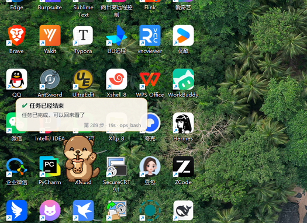
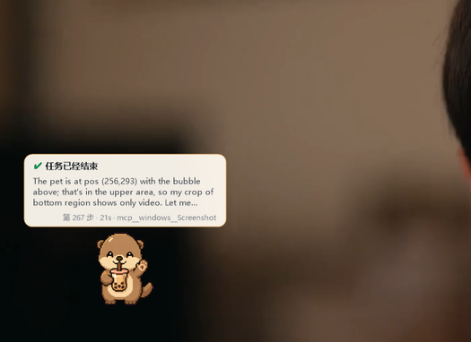
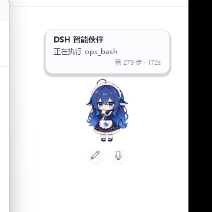
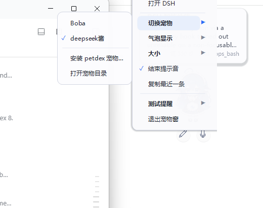
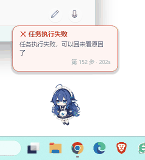

# dsh-pet · DSH 常驻宠物浮层

把 Codex 桌面版的"智能伙伴"搬到了 DeepSeek Harness：一只始终浮在屏幕最上层的宠物，
**不打开面板也能看到当前对话在做什么**，**任务一结束立刻冒出来提醒你**，还能从
[petdex.dev](https://petdex.dev) 直接装别人的宠物。


| 任务结束提醒 | 面板最小化时仍在 | 拖到屏幕任意位置 |
| --- | --- | --- |
|  |  |  |

> 方案与关键设计：[docs/DESIGN.html](docs/DESIGN.html)（带图，推荐）／ [docs/DESIGN.md](docs/DESIGN.md)。
> 失败态长这样：`docs/img/21-alert-0.2.png`（红 ✕ + 原因）。

| 悬停工具条（✎ 写字 / 🎤 语音） | 圆角半透明菜单 | 提示音结束提醒 |
| --- | --- | --- |
|  |  |  |

## 它解决什么问题

DSH 面板被最小化/被其他窗口盖住之后，你不知道 agent 还在跑、跑到哪一步、是不是已经跑完在等你。
这个插件在系统层面开了一个独立浮层：**不属于 DSH 窗口，不受任何面板裁剪**，
把"最新一条消息 + 进度"一直摆在桌面上。

## 特性

- **常驻浮层**：分层窗口 + 逐像素命中测试，宠物之外的区域完全点击穿透，不挡你操作别的软件。
- **实时进度**：标题（会话名）、正文（最新一条 assistant 消息）、页脚（第几轮 · 第几步 · 用时 · 当前工具）。
- **结束必达**：根会话 `turn/end` 一到——气泡变暖色 `✔ 任务已完成，可以回来看了`（失败是红 ✕ + 原因）、
  宠物先跳一下再招手、响一声提示音；默认气泡停留 5 秒，之后宠物留在屏幕上继续招手，点一下即"我知道了"。
- **等你会意**：审批 / 提问挂起时切到 `waiting` 状态与"在等你确认后继续…"文案（只跟当前会话，后台子 agent 的审批不会抢气泡）。
- **点击即回**：单击宠物可恢复现有 DSH 窗口，包括最小化和隐藏到托盘的情况。切换失败时提示使用任务栏或托盘。
- **写入和听写**：宠物旁的小横条可展开写入、听写和消息三个入口。输入条默认一行，可选择目标会话。点写入按钮或按 Esc 可收起，再次点语音按钮可停止听写。
- **显示或隐藏**：在 DSH 侧栏底部点击「显示宠物」或「隐藏宠物」，设置会保留。也可用 /pet show 或 /pet hide。
- **圆角半透明菜单**：自绘分层菜单，深浅色主题自适应、悬停高亮、子菜单靠近屏幕右边缘会自动翻到左边；
  菜单里还有一项「复制最近一条」，把气泡正文送进剪贴板。
- **气泡折叠**：点气泡或消息按钮可收起和展开。手动收起后，新通知只显示在消息入口，点击可查看最近内容。自动显示模式仍遵守原有气泡时间设置。
- **全屏拖动 + 位置持久**：拖到任意位置、跨显示器都行；松手即写盘，重启浮层 / 重启 DSH 都回到原处，
  分辨率或 DPI 变化时自动夹回最近屏幕的可见区域。
- **宠物自定义**：菜单里粘贴 petdex 的宠物链接即可安装，装完立即换装、无需重启；装几个就能勾选切换；缩放 40%–100%。
- **随 DSH 生死**：宿主进程一退出，浮层 1 秒内自己退出；下次打开 DSH 自动重新出现，不留孤儿窗口。
- **不会再把对话弄丢**：`config.json` 原子写入 + `.bak`/`.prev` 双备份；文件损坏时先留档 `config.json.corrupt-<时间>` 再回滚，
  实在不行才用默认值——只碰浮层自己的配置文件，不碰 DSH 的会话库。
- **0.3 修掉了 0.2 的偶发卡死**：0.2 抢前台时用了 `AttachThreadInput`（会把浮层线程挂进 Electron 的输入队列），
  外加"找不到窗口就重启 DSH"的兜底（等于开第二个实例）。0.3 删掉这两条路径，改成 `ShowWindowAsync` + `SetWindowPos` +
  `BringWindowToTop` + `SetForegroundWindow`，失败只闪任务栏。
- **0.3.6**：统一气泡、工具条和右键菜单的浅色与深色样式。DSH 侧栏底部提供宠物显示开关。
- **0.3.5**：写入改为宠物旁的单行输入条，听写与草稿共用入口。点气泡或工具条末尾可收起或展开通知，收起后保留最近一次完成或失败的内容。
- **0.3.4**：修复宠物草稿发送时的请求编号错误，输入框可随时关闭。拖动时同时提交画面和位置。右键可隐藏宠物，隐藏后可用 Windows 托盘图标或 `/pet show` 恢复。
- **0.3.3**：通过 DSH 自己的单实例入口请求恢复窗口。交接失败时，提示用任务栏或托盘恢复。
- **0.3.2**：单击恢复 DSH 时合并重复请求。右键主、子菜单分别绘制，空白区域可点击穿透。写入和听写共用草稿，发送前显示目标会话。
- **0.3.1 修掉了"框"和"拖影"**：气泡外面那圈阴影 + 1px 常驻描边去掉，只剩扁平半透明填充（提醒态才靠填充色 + ✔/✕ 区分）；
  拖动时位置一变就立刻补推一帧（8 ms 节流），不再留下上一帧的残影。
- **0.3.1 修好了 🎤**：0.3.0 里点麦克风没反应，是因为写作窗在自己句柄还没创建时就去 `BeginInvoke` 开录音
  （`overlay.log` 里攒了 8 次 `InvalidOperationException`）；现在改到窗口显示后再启动录音。
- **`/pet` 命令**：`/pet status`、`/pet install boba`、`/pet bubble 8`、`/pet say 帮我看下日志`、`/pet test failed`……

## 安装

前置：Windows（浮层是原生 C#/.NET Framework 4.x 进程，编译用系统自带 `csc.exe`）、
DSH ≥ 0.2.1-rc.3、Node ≥ 22.6。

```text
# 在 DSH 里执行（或让 agent 执行）
plugin_manager action=install_bundle target="C:\Users\KING\Documents\deepseek-harness\default-workspace\projects\dsh-pet"
```

安装成功后插件会自己：

1. 在 DSH 的 web 端口上挂 `/x-dsh-pet/*`（仅回环地址 + 每次启动随机 token；前缀被占用时自动退到 `/x-dsh-pet-2`，
   并把实际前缀写进 `~/.dsh/pets/runtime.json`）；
2. 用 `csc.exe` 把 `native/PetOverlay.cs` 编译到 `~/.dsh/pets/bin/PetOverlay.exe`；
3. 拉起浮层进程（带单实例互斥量，重启时先杀掉旧进程）；
4. 如果本地还没有任何宠物，自动从 petdex 装一只 `deepseek`（也就是 `deepseek酱`）。

不想自动装？把 `~/.dsh/pets/config.json` 里的 `pet` 置空并删掉 `~/.dsh/pets/deepseek/` 即可。

## 使用

**宠物本体**

| 操作 | 效果 |
| --- | --- |
| 左键拖动 | 全屏任意位置移动（松手即存盘，重启回到原处） |
| 单击 | 把 DSH 主窗口叫到前台；若有结束提醒，顺便"我知道了" |
| 鼠标停留 | 宠物下方浮出 ✎ / 🎤 两个圆钮，离开 300 ms 自动收起（贴屏幕底边时翻到气泡上方） |
| 点 ✎ | 在宠物旁打开输入框，确认目标会话后编辑草稿（Enter 发送 / Esc 收起） |
| 点 🎤 | 打开同一个输入框并开始本机连续听写。点停止后检视并编辑听写结果，再决定是否发送 |
| 右键 | 打开自绘菜单（见下） |
| 双击 | 同单击：把 DSH 调到前台 |

**右键菜单**

- **打开 DSH**（恢复现有窗口。切换失败时请使用任务栏或托盘）
- **切换宠物 ▶**（已装宠物逐个列出并 ✓，另有「安装 petdex 宠物…」「打开宠物目录」）
- **气泡显示 ▶**（3 秒 / ✓5 秒 / 8 秒 / 一直显示 / 关闭气泡）
- **大小 ▶**（40% / 55% / 70% / 85% / 100%）
- **结束提示音**（勾选式）
- **测试提醒 ▶**（成功演练／失败演练，立刻演一遍整套提醒）
- **复制最近一条**（把气泡当前正文复制到剪贴板）
- **退出宠物窗**

> 菜单可用鼠标悬停展开子菜单，也可在菜单获得焦点时用键盘操作。键盘事件只有
> 在菜单恰好持有焦点时才会到达，所以 ↑↓←→ / Enter / Esc 属于「有则更好」的补充路径，
> 不作为主要操作方式。
>
> 原来的「重置位置」已经删掉——位置本来就是持久的，想去哪儿就拖到哪儿。

**装 petdex 宠物**

三种输入都支持（菜单 → 切换宠物 → 安装 petdex 宠物…）：

```text
boba                                  # 纯 slug
https://petdex.dev/pets/boba          # 宠物页链接
C:\path\to\pet-folder-or.zip        # 本地目录 / 本地 zip
```

装完后宠物会立刻换装并写进配置。等价命令：`/pet install https://petdex.dev/pets/boba`。

**对话里的 `/pet` 命令**（不依赖浮层的自检入口，浮层起不来时也能用）

```text
/pet                        # 状态：浮层是否在跑、当前宠物、开关、缩放、气泡时长、待确认提醒、日志路径
/pet pets                   # 列出已装宠物
/pet pet deepseek           # 切换宠物
/pet scale 70               # 缩放百分比
/pet bubble 8               # 气泡停留 8 秒（0 = 一直显示）
/pet say 帮我看一下构建日志   # 让浮层往当前会话发一条消息（和 ✎ 输入框同一条链路）
/pet install boba           # 装 petdex 宠物（slug 或链接）
/pet test                   # 演练成功提醒；/pet test failed 演练失败提醒
/pet sound off              # 关提示音（bubble / sound 同理）
```

**设置项一览**（都存在 `~/.dsh/pets/config.json`，菜单改动会即时落盘）

| 键 | 默认 | 说明 |
| --- | --- | --- |
| `pet` | 自动装 `deepseek` | 当前宠物 id |
| `scale` | `0.55` | 40%–150% |
| `bubbleMs` | `5000` | 气泡停留毫秒数，`0` = 一直显示 |
| `alertMs` | `30000` | 结束提醒气泡的停留毫秒数 |
| `bubble` / `sound` | `true` | 气泡总开关 / 结束提示音 |
| `pos` | `null` | 宠物锚点（底边中点）屏幕坐标，拖动后自动写入 |
| `lang` | `zh` | 气泡文案语言 |

## 验收步骤（对着验收标准逐条过）

1. **最小化也能看到对话**：把 DSH 主窗口最小化，宠物仍在桌面上，气泡正文随 agent 动作实时变化；
   没有新进展时气泡 5 秒自动收起，只留宠物（不永久占屏）。
   证据：`docs/img/03-minimized.png`、`docs/img/23-minimized-alert-0.2.png`（最小化状态下收到的失败提醒）。
2. **任务结束有明确提示**：等一轮回复结束——宠物跳一下、挥手、气泡变暖色
   `✔ 任务已经结束 / 任务已完成，可以回来看了`、响提示音；失败是红 `✕ 任务执行失败`。
   `~/.dsh/pets/logs/overlay.log` 出现 `alert shown id=… kind=completed`。
   证据：`docs/img/21-alert-0.2.png`。不想等就右键 →「测试提醒 → 成功/失败演练」或 `/pet test`。
3. **能加载 petdex.dev 的宠物**：菜单 → 切换宠物 → 安装 petdex 宠物… → 输入 `boba` →
   提示 `已安装 Boba（8 列 × 11 行 · 192×208）`，宠物立刻换装。证据：`docs/img/07-boba.png`，
   产物在 `~/.dsh/pets/boba/`。
4. **可拖到全屏任意位置且不被裁剪**：把宠物从右上拖到左下（跨过 DSH 窗口边界、跨显示器），
   既不被面板裁掉，也不挡下层点击（宠物以外逐像素穿透）。证据：`docs/img/04-dragged.png`。
5. **配置可保存并复现**：拖动 / 换缩放 / 换宠物 → 杀掉 `PetOverlay.exe`（宿主会自动重启）或禁用再启用插件
   → 位置、缩放、宠物原样恢复。证据：`docs/img/22-restored-0.2.png`。
6. **跟随 DSH 生死**：退出 DSH → 浮层 1 秒内消失（`overlay.log` 记 `DSH 已退出，浮层退出`）；
   重新打开 DSH → 宠物自动回来。按保存的显示状态恢复。
7. **点击即回**：把 DSH 最小化或"关闭到后台"（窗口隐藏），单击宠物 → 主窗口恢复并到前台
   （`overlay.log` 记 `focused DSH window (click)`）。
8. **就地写字 / 语音**：鼠标停在宠物上 → 宠物**下方**浮出 ✎ / 🎤 → 点 ✎ → 输入 → Enter →
   输入框里标出的会话收到一条消息。🎤 说完后点「停止」，识别结果插入草稿，确认后才发送。
9. **没有外层框、按钮在下方**：气泡只有柔和投影（提醒态才有描边），✎ / 🎤 是宠物下方的两个圆钮；
   把宠物拖到屏幕最底部，两个按钮会翻到气泡上方。
   证据：`docs/img/26-actions-below-0.3.png`、`docs/img/27-actions-flip-0.3.png`。
10. **菜单可点**：右键 → 任选一项都能生效（`overlay.log` 记 `menu pick <id>`）。
11. **不再卡死**：连续使用半小时以上，`host.log` 无 `loop lag` 长阻塞（插件重载时的一次性停顿除外），
    `overlay.log` 无 `ui stall`；会话文件不丢（`config.json` 有 `.bak`/`.prev`）。
   本轮实测：1 秒间隔连续 10 分钟共 590 次请求、零尖峰（`{"requests": 590, "seconds": 600.5, "spikes": []}`），
   并且跨了一次系统休眠——醒来后浮层进程仍在、`/state` 立刻有响应、58 个会话缓存 JSON 全部可解析。

12. **没有外层框（0.3.1 复验）**：气泡只剩扁平半透明填充，放大看边缘没有阴影环、没有描边；
    同一位置用 0.3.0 与 0.3.1 两个二进制各拍一张对比——
    `docs/img/32-frame-before-0.3.1.png`、`33-frame-after-0.3.1.png`、`34-frame-compare-0.3.1.png`。
13. **拖动没有残影（0.3.1 复验）**：把宠物拖进一片空区域再拖走，趁它不在时截干净基准；
    拖回来时连拍，`python tools/ghostcheck.py --ref 基准.png --frames "帧*.png" --after 松手后.png`
    应打印 `[OK]`：单帧最多 2 块（气泡 + 宠物），松手后与基准逐像素一致。
    证据：`docs/img/35-drag-no-residue-0.3.1.png`。
14. **麦克风可用（0.3.1 复验）**：点 🎤 → 写作窗弹出、按钮文案变「停止」（已进入录音）、
    `overlay.log` 不再出现 `在创建窗口句柄之前…`。证据：`docs/img/36-mic-compose-0.3.1.png`。

自动化回归：

```powershell
cd projects\dsh-pet
node --test              # 回归测试：状态归约 / petdex 解析 / 网格校验 / 行协议 / 路由前缀 / 配置备份与回滚
```

## 卸载

```text
plugin_manager action=remove_bundle target=dsh-pet
```

插件停用时会 `taskkill` 掉浮层进程，不留孤儿窗口；`~/.dsh/pets/` 里的宠物与配置会保留，
下次装回来直接接着用（想彻底清干净就删掉这个目录）。

## 排障

| 现象 | 检查 |
| --- | --- |
| 宠物没出现 | `~/.dsh/pets/logs/host.log` 是否有 `浮层已编译 → …` / `浮层已启动 pid=…`；没有就是 csc 编译失败，日志里有原文 |
| 宠物出现但不动 | `~/.dsh/pets/logs/overlay.log` 是否在刷 `poll failed`；`host … unreachable` 说明宿主没起来或端口变了 |
| 探针 404 | 读 `~/.dsh/pets/runtime.json` 的 `prefix`：热重载后可能是 `/x-dsh-pet-2`，重启 DSH 回到 `/x-dsh-pet` |
| 装宠物失败 | 面板会回显原因（下载超时最常见，petdex 素材约 2.4 MB，慢网络多试一次） |
| 气泡里没有正文 | 那是"还没说第一句话"的正常空状态，页脚仍会显示进度 |
| 宠物消失得太快 | 检查 DSH 是否还活着：浮层用 `--dsh-pid` 盯宿主，宿主一退就跟着退（这是特性） |
| 点宠物没把 DSH 拉出来 | `overlay.log` 看 `focused DSH window (click) hwnd=…`，或 `foreground refused (click), taskbar flashed`（Windows 不许抢前台时只闪任务栏，再点一次通常就上来了）；0.3 起**不会**再替你重启 DSH |
| 0.2 那种整机卡死 | 0.3 已修复（`AttachThreadInput` + 重启 DSH 兜底两条路径都删了）。想看是否还有长阻塞：`host.log` 的 `loop lag >n ms`、`overlay.log` 的 `ui stall >n ms`；真卡住浮层时 `/pet restart` 重拉浮层 |
| 菜单点了没反应 | 0.3 修了 `SetCapture` 悬挂：旧版本宠物窗口会一直抓着鼠标，导致菜单收不到点击。若仍复现，`overlay.log` 应有 `released stale capture` |
| 无法开始听写 | 输入框会显示本机语音引擎或麦克风错误，仍可继续键盘输入 |
| 还能看到宠物外面的"框" | 0.3.1 已把气泡的三层阴影与 1px 常驻描边删掉。若仍觉得有边缘，那是气泡的填充色与背景对比：菜单 → 气泡显示 → 关闭气泡，或把宠物拖到深色区域对比 `docs/img/34-frame-compare-0.3.1.png` |
| 拖动有拖影 | 0.3.1 在位置更新后 8 ms 内补推一帧。仍复现就用 `python tools/ghostcheck.py --ref … --frames … --after …` 抓证据（脚本会打印每帧块数与松手后的最大通道差） |
| 想抓卡死现场 | 建个标记文件 `~/.dsh/pets/profile.on`（或 `DSH_PET_PROFILE=1` 启动 DSH），阻塞 >1.5s 会自动落 `~/.dsh/pets/logs/lag-<ISO>.cpuprofile`，并记 `loop block <n>ms top=<函数@文件:行>`；分析结论见 `docs/lag-analysis.md` |
| DSH 界面卡住几秒 | 先看是不是刚启用/停用/安装过插件：`dsh-hmr` 重建 profile 时会同步遍历目录（单次 1–1.8s，累计 2.3–8.2s），这是 DSH 侧的已知点，`docs/lag-analysis.md` 有完整证据与两条缓解建议 |
| 想彻底不要气泡 | 菜单 → 气泡显示 → 关闭气泡；或 `/pet bubble off` |

## 目录结构

```text
projects/dsh-pet
├── cordis.patch.yml        # bundle 声明：insert 本插件
├── package.json            # dsh.bundle.patch / engines / exports
├── icon.svg                # 插件图标（蓝色徽章 + 对话气泡脸）
├── locale/{zh,en}.json     # 插件页标题与描述
├── src/
│   ├── index.js            # 插件入口：事件监听 + 路由挂载 + 浮层守护 + /pet
│   ├── pet-state.js        # 纯函数状态归约器（会话事件 → 展示状态）
│   ├── pets.js             # petdex 安装 / 网格校验 / webp→png
│   ├── routes.js           # /x-dsh-pet/* 行协议 HTTP 接口（含 /say）
│   ├── config-store.js     # 配置原子持久化（.bak/.prev/坏文件留档）
│   ├── profiler.js         # 事件循环阻塞采样 → lag-*.cpuprofile
│   └── overlay.js          # csc 编译（含 System.Speech / 图标）+ 进程守护
├── native/
│   ├── PetOverlay.cs       # 入口：参数、日志、HTTP、状态解析、单实例
│   ├── NativeMethods.cs    # Win32 P/Invoke、找窗口 / 抢前台 / 进程存活
│   ├── Layered.cs          # 分层窗口表面（预乘 alpha 合成）
│   ├── PetForm.cs          # 宠物窗口：气泡 / 工具条 / 拖动 / 轮询
│   ├── OverlayMenu.cs      # 自绘圆角半透明菜单（两列 + 左翻）
│   ├── ComposeWindow.cs    # 就地写字输入框 + 输入对话框
│   ├── VoiceInput.cs       # System.Speech 语音识别（可选编译）
│   ├── app.manifest        # PerMonitorV2 DPI 感知
│   └── app.ico             # 多尺寸图标（tools/make-icon.py 生成）
├── tools/
│   ├── make-icon.py        # 图标生成脚本
│   ├── probe.ps1           # UI 响应 + /state 时延探针（CSV）
│   ├── soak.ps1            # 固定操作序列长跑
│   └── ghostcheck.py       # 拖动残影检测（连拍帧 vs 干净基准）
├── test/                   # node:test 单测（35 例）
└── docs/
    ├── DESIGN.md           # 方案与关键设计
    ├── DESIGN.html         # 同上，带图版本（推荐阅读）
    ├── lag-analysis.md     # 卡死根因分析（CPU profile 栈、触发条件、对照组）
    └── img/                # 验收截图
```

## 运行时产生的文件

```text
~/.dsh/pets/
├── config.json             # pet / scale / bubbleMs / alertMs / bubble / sound / lang / pos
├── runtime.json            # 本次运行的 host 地址、实际前缀、token、dshPid/dshExe（仅本机）
├── bin/PetOverlay.exe      # 编译产物
├── logs/host.log           # 宿主侧日志
├── logs/overlay.log        # 浮层日志
└── <pet-id>/               # 每只宠物：pet.json + spritesheet.png
```
