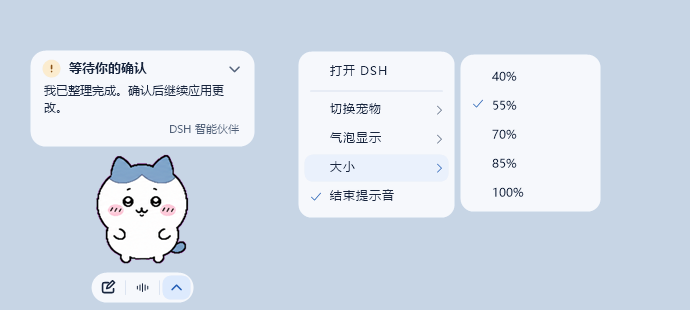
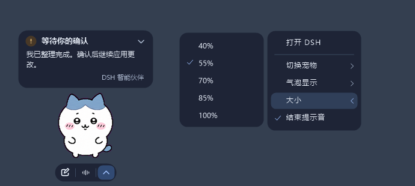

# dsh-pet · DSH 智能伙伴浮层

在 Windows 桌面上查看 DeepSeek Harness 的任务进度和完成提醒。宠物可跨屏拖动，位置和大小会保存，也能从 Petdex 安装新宠物。





配图由 0.4.1 的浮层渲染，使用演示任务内容。

## 安装插件

环境要求为 Windows、DSH 0.2.1-rc.3 至 0.3.0 之前的版本、Node.js 22.6 或更高。浮层使用 Windows 的 .NET Framework 4.x 编译。录音取决于系统已安装的语音识别引擎和麦克风设置。

下载 `dsh-pet-0.4.1.tgz`。在 DSH 中用插件安装工具选择这个文件，或把下方路径换成安装包的实际位置。

```text
plugin_manager action=install_bundle target="C:\Downloads\dsh-pet-0.4.1.tgz"
```

安装后在「插件」页启用「智能伙伴浮层」。从本地源码开发时，也可以把 `target` 指向解压后的源码目录。

## 桌面操作

| 操作 | 效果 |
| --- | --- |
| 单击宠物 | 恢复 DSH 窗口 |
| 拖动宠物 | 移动位置，松手后保存 |
| 悬停后点铅笔 | 打开单行草稿。Enter 发送，Esc 收起；中文输入法选词时 Enter 先确认候选词 |
| 悬停后点声波，再点圆点 | 启停本机录音。录音过程不弹输入框，识别到的文字可通过铅笔入口查看 |
| 点铃铛或向上箭头 | 展开或收起通知气泡，铃铛角标显示未读通知数量 |
| 右键宠物 | 打开 DSH、切换或安装宠物、调整气泡和大小、切换结束提示音 |
| DSH 侧栏左下角 | 显示或隐藏宠物，状态会保存 |

草稿在确认发送时创建新的 DSH 会话。录音停止后先查看草稿，再决定是否发送。

## 安装和更换宠物

右键宠物 →「切换宠物」→「安装 petdex 宠物」。支持以下输入。

- Petdex 名称，例如 `hachiware-2`。
- Petdex 页面，例如 `https://petdex.dev/zh/pets/hachiware-2`。
- 网页复制的 `npx petdex@latest install hachiware-2`。
- 含配置和贴图的本地 ZIP 或文件夹路径。

插件使用 [Petdex Desktop 的官方下载接口](https://github.com/crafter-station/petdex/blob/main/src/app/api/install-pet/%5Bslug%5D/route.ts) 在后台下载，成功后自动切换到新宠物。粘贴 `npx` 命令时，插件提取其中的宠物名称。下载与校验期间原宠物继续显示。

## 排障和开发

- 宠物没出现时，先检查 DSH 左下角的显示开关。也可在 DSH 输入 `/pet status` 检查状态，使用 `/pet restart` 重启浮层。
- 本地源码更新后，在 DSH 插件页关闭再启用「智能伙伴浮层」，让宿主和浮层一起重载。
- 配置存放在 `~/.dsh/pets/config.json`，日志在 `~/.dsh/pets/logs/`。
- 源码包包含 `src/`（DSH 插件与下载逻辑）、`native/`（Windows 浮层）、`locale/`、`test/` 和 `docs/`。在源码根目录运行 `npm test` 执行测试，运行 `npm pack` 生成插件安装包。
